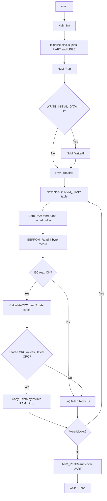

# Read-All-at-Startup: NvM_ReadAll() on the S32K144

A simplified, AUTOSAR-inspired **Non-Volatile Memory (NvM) manager** for the NXP S32K144.
At ECU startup, `NvM_ReadAll()` walks every registered block, loads it from an external
**M24C04 I2C EEPROM** into its RAM mirror, verifies it with a **CRC-8**, and logs which
blocks failed. Results are printed over UART to a serial terminal.

## Table of contents

- [Introduction](#introduction)
- [Features](#features)
- [Components used](#components-used)
- [Tech stack](#tech-stack)
- [Architecture](#architecture)
- [Data layout](#data-layout)
- [Procedure](#procedure)
- [Expected output](#expected-output)
- [Testing the failure path](#testing-the-failure-path)
- [Project structure](#project-structure)
- [Design decisions](#design-decisions)
- [Limitations](#limitations)
- [Future improvements](#future-improvements)

## Introduction

In an automotive ECU, data such as calibration values, counters and configuration must survive
power cycles. It is stored in non-volatile memory and copied into RAM at startup. Because
stored data can be corrupted (power loss during a write, wear, noise on the bus), every block
carries a checksum that is verified before the application is allowed to trust it.

This project implements that startup step in plain C:

1. Register a table of NV blocks (ID, EEPROM address, RAM mirror, length).
2. Read every block in a single pass.
3. Verify each block with a CRC.
4. Copy valid data into its RAM mirror and log the IDs of blocks that failed.

One failing block never stops the pass, so the ECU always gets the full picture at startup.

## Features

- Block table with ID, EEPROM address, RAM mirror pointer and length per block
- 3 blocks, each stored as a 4-byte record: **3 data bytes + 1 CRC byte**
- CRC-8 integrity check (polynomial `0x07`, initial value `0xFF`)
- Failed blocks leave their RAM mirror zeroed, so stale data is never used
- Failure log: failed block count and IDs, reported over UART
- Distinguishes I2C read failures from CRC mismatches
- Optional first-run write (`WRITE_INITIAL_DATA`) to program the EEPROM with sample data
- Page-safe EEPROM writes with write-cycle delay

## Components used

### Hardware

| Component | Role |
|---|---|
| NXP S32K144 evaluation board | Microcontroller running the NvM code |
| M24C04 EEPROM (512 bytes, 16-byte pages) | Non-volatile storage, I2C address `0x50` |
| USB-to-serial connection (OpenSDA or external adapter) | UART output to the PC |
| Jumper wires and I2C pull-up resistors | EEPROM wiring |

### Wiring

Fill in the pins from your pin configuration:

| Signal | MCU pin | EEPROM pin |
|---|---|---|
| I2C SDA (LPI2C0) | `<your pin>` | SDA |
| I2C SCL (LPI2C0) | `<your pin>` | SCL |
| UART TX (LPUART1) | `<your pin>` | n/a |
| Power / GND | 3.3 V / GND | VCC / VSS |

### Software modules

| Module | Responsibility |
|---|---|
| `NvM_Init` | Initializes clocks, pins, LPUART and LPI2C |
| `NvM_Run` | Startup sequence: optional write, ReadAll, print results |
| `NvM_WriteAll` | Writes sample data plus CRC for each block (test helper) |
| `NvM_ReadAll` | Reads each block, checks CRC, fills RAM mirrors, logs failures |
| `NvM_PrintResults` | Prints failed count and failed block IDs |
| `CalculateCRC` | CRC-8 over the data bytes |
| `EEPROM_Read` / `EEPROM_WriteRecord` | I2C access to the M24C04 |
| `UART_Print` | Blocking UART logging |

## Tech stack

| Area | Technology |
|---|---|
| Language | C (C99) |
| MCU | NXP S32K144 (ARM Cortex-M4F) |
| IDE | NXP S32 Design Studio 3.5 |
| Drivers | S32K SDK: `CLOCK_DRV`, `PINS_DRV`, `LPUART_DRV`, `LPI2C_DRV`, `OSIF` |
| Peripherals | LPI2C0 (EEPROM), LPUART1 (logging) |
| Terminal | PuTTY (serial) |
| Version control | Git and GitHub |

## Architecture



### Call hierarchy

```
main()
 ├─ NvM_Init()
 └─ NvM_Run()
     ├─ NvM_WriteAll()     -> CalculateCRC(), EEPROM_WriteRecord()
     ├─ NvM_ReadAll()      -> EEPROM_Read(), CalculateCRC()
     └─ NvM_PrintResults()
```

Only `NvM_Init()` and `NvM_Run()` are public. Everything else is `static` inside `nvm.c`.

### Block table

Each registered block is described by one table entry:

```c
typedef struct{
    uint16_t Block_ID;
    uint16_t EEPROM_Addr;
    uint8_t *RAM_Mirror;
    uint16_t length;
} NvM_BlockType;
```

`NvM_ReadAll()` simply loops over this table, so adding a block means adding one entry.

## Data layout

Each block is stored as one record: the data bytes followed by their CRC.

```
record (RECORD_SIZE = 4 bytes)

 index:    [0]    [1]    [2]    [3]
         +------+------+------+------+
         | data | data | data | CRC  |
         +------+------+------+------+
```

### EEPROM memory map

| Block | ID | Address | Record size | Sample data |
|---|---|---|---|---|
| 1 | 1 | `0x000` | 4 bytes | `08 05 06` |
| 2 | 2 | `0x010` | 4 bytes | `20 06 07` |
| 3 | 3 | `0x020` | 4 bytes | `01 01 07` |

Each block starts on its own 16-byte page, so a write never crosses a page boundary.

### CRC

- CRC-8, polynomial `0x07`, initial value `0xFF`, no final XOR
- Computed over the **data bytes only**, not over the stored CRC
- The `0xFF` initial value means an erased EEPROM (all `0xFF`) fails the check instead of passing by coincidence
- An 8-bit CRC detects all single-bit errors and most burst errors, but roughly 1 in 256 random corruptions can still slip through

## Procedure

### 1. Get the project

```bash
git clone https://github.com/EstherJ07/Read-All-at-Startup.git
```

### 2. Wire the hardware

Connect the M24C04 to LPI2C0 (SDA, SCL, power, ground) as in the wiring table, and make sure the board's UART is connected to the PC.

### 3. Import and build

1. Open S32 Design Studio and import the project.
2. Build it. The build should finish with 0 errors and 0 warnings.

### 4. Open the terminal

Open PuTTY on the board's COM port with the baud rate from your LPUART configuration (8 data bits, no parity, 1 stop bit).

### 5. First run: write sample data

1. In `src/nvm.h`, set `#define WRITE_INITIAL_DATA 1U`.
2. Flash and run. The program writes the three records, then reads them back and verifies them.

### 6. Normal run: read only

1. Set `#define WRITE_INITIAL_DATA 0U`.
2. Rebuild, flash and reset the board.
3. The three blocks should still pass, which proves the data survives power cycles in the EEPROM.

## Expected output

```
Reading block ID: 1
Record: 08 05 06 29
Stored CRC: 29
Calculated CRC: 29
CRC OK - BLOCK VALID

Reading block ID: 2
Record: 20 06 07 03
Stored CRC: 03
Calculated CRC: 03
CRC OK - BLOCK VALID

Reading block ID: 3
Record: 01 01 07 40
Stored CRC: 40
Calculated CRC: 40
CRC OK - BLOCK VALID

NvM ReadAll finished

Failed block count: 0
ALL BLOCKS VALID
```

## Testing the failure path

The `crc-error-test` branch injects a deliberate error so you can see failures being logged.
It corrupts block 2 after its CRC is computed, so the EEPROM stores bad data with a good CRC.

```bash
git checkout crc-error-test
```

The injected line in `NvM_WriteAll()`:

```c
if (i == 1U){ record[0] ^= 0xFFU; }   /* corrupt block 2 after its CRC is computed */
```

Expected output for block 2 and the summary:

```
Reading block ID: 2
Record: DF 06 07 03
Stored CRC: 03
Calculated CRC: 28
CRC MISMATCH

Failed block count: 1
Failed block ID: 2
```

Blocks 1 and 3 still report `CRC OK - BLOCK VALID`, which shows that one failure does not stop the pass.

A second test is to disconnect the EEPROM's SDA or SCL line and reset the board. The reads then fail with `I2C READ FAILED` and all three block IDs are logged.

**After testing:** flash the `main` branch once with `WRITE_INITIAL_DATA` set to `1U` to overwrite the corrupted block with good data.

## Project structure

```
Read-All-at-Startup/
├── board/                  Generated pin mux, clock and SDK configuration
├── src/
│   ├── main.c              Calls NvM_Init() and NvM_Run()
│   ├── nvm.h               Configuration defines and public API
│   └── nvm.c               Block table, CRC, EEPROM driver, NvM_ReadAll()
├── final_project.mex       S32 Configuration Tools file
└── README.md
```

## Design decisions

- **One pass, no early exit.** A failed block is logged and the loop continues, so every block is checked.
- **RAM mirror cleared before each read.** A failed block never holds stale data.
- **CRC over data only.** The stored CRC is excluded from its own calculation.
- **Static helpers.** Only the init and run functions are exposed, which keeps the module's interface small.
- **Synchronous and blocking.** Chosen for clarity. Real AUTOSAR NvM is asynchronous.

## Limitations

- Blocks must be located below address `0x100`. The M24C04's ninth address bit (A8) is carried in the I2C device address, and that case is not handled.
- No ROM defaults: a failed block stays zeroed.
- No redundant block copies.
- `WRITE_INITIAL_DATA = 1` rewrites the EEPROM on every boot, which wears it over time. Use it only for the first run.
- The EEPROM write delay is a fixed 6 ms rather than ACK polling.
- The `Record:` debug print is hard-coded to 4 bytes.

## Future improvements

- Load ROM default values for failed blocks
- Redundant block storage with a fallback copy
- Write only the blocks that fail, instead of rewriting everything
- ACK polling instead of the fixed write delay
- Handle EEPROM addresses at `0x100` and above
- Asynchronous operation with a job queue, closer to AUTOSAR NvM
- A real application that consumes the validated RAM mirrors
