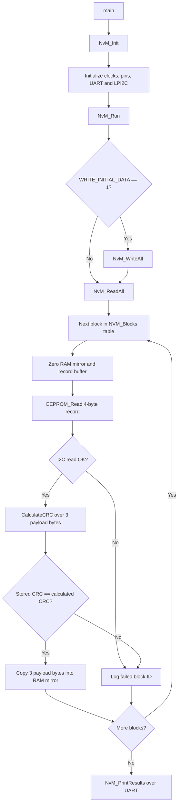

# Exercise 19: NvM Read-All-at-Startup

[](https://en.cppreference.com/w/c)
[](https://www.nxp.com/)
[-lightgrey.svg)](#hardware-and-software)
[](#testing-and-validation)

**An embedded C exercise implementing EEPROM Read-All, RAM-mirror restoration, CRC-8 validation, and failed-block reporting over UART on the NXP S32K144.**

> **Project status:** Working. The firmware has been run on an S32K144 board with an M24C04 EEPROM, and the captured UART output for a valid run and a CRC-mismatch run is shown in [Testing and Validation](#testing-and-validation).

## Overview

This project implements a simplified NvM-style Read-All operation for an embedded ECU application using an NXP S32K144 microcontroller and an external **M24C04 I²C EEPROM**.

At startup, the firmware iterates over a registered block table, reads each block record from the EEPROM, validates the payload using **CRC-8**, and copies valid payload bytes into the associated RAM mirror. If an I²C read fails or the CRC does not match, the block ID is added to a failed-block list, the RAM mirror stays zeroed, and the outcome is reported through UART.

One failing block never stops the pass, so every block is always checked.

This is an educational implementation inspired by automotive non-volatile memory management concepts. It is **not represented as a fully AUTOSAR-compliant NvM module**.

## Problem Statement

After an ECU reset or power cycle, application data may need to be restored from non-volatile memory. Stored data can be corrupted by power loss during a write, cell wear, or bus noise, so the software should read each configured block, check its integrity, restore valid data into RAM, and identify blocks that could not be restored.

## Objectives

- Iterate over registered blocks using a block configuration table.
- Read EEPROM records through the LPI2C master driver.
- Verify each record's payload using CRC-8.
- Copy valid payloads into their associated RAM mirrors.
- Record failed block IDs for read failures and CRC mismatches.
- Report the failed-block count and IDs over UART.

## Features

- Block table with ID, EEPROM address, RAM mirror pointer and length per block
- 3 blocks, each stored as a 4-byte record: **3 payload bytes + 1 CRC byte**
- CRC-8 integrity check (polynomial `0x07`, initial value `0xFF`)
- RAM mirror cleared before each read, so a failed block never holds stale data
- Failure log with count and IDs, covering both I²C read failures and CRC mismatches
- Optional first-run write (`WRITE_INITIAL_DATA`) to program the EEPROM with sample data
- Page-safe EEPROM writes with a write-cycle delay

## Hardware and Software

### Hardware

| Component | Role |
|---|---|
| NXP S32K144 evaluation board | Microcontroller running the NvM code |
| M24C04 EEPROM (512 bytes, 16-byte pages) | Non-volatile storage, I²C address `0x50` |
| USB connection | Programming, debugging and power |


### Software

| Area | Technology |
|---|---|
| Language | C |
| MCU | NXP S32K144 (ARM Cortex-M4F) |
| IDE | NXP S32 Design Studio 3.5 |
| Drivers | S32K SDK: `CLOCK_DRV`, `PINS_DRV`, `LPUART_DRV`, `LPI2C_DRV`, `OSIF` |
| Peripherals | LPI2C0 (EEPROM), LPUART1 (logging) |
| Terminal | PuTTY (serial) |
| Version control | Git and GitHub |

## Architecture



The application calls `NvM_Init()` and then `NvM_Run()` from `main()`, which then falls into an infinite loop.

### Call hierarchy

```
main()
 ├─ NvM_Init()
 └─ NvM_Run()
     ├─ NvM_WriteAll()     -> CalculateCRC(), EEPROM_WriteRecord()
     ├─ NvM_ReadAll()      -> EEPROM_Read(), CalculateCRC()
     └─ NvM_PrintResults()
```

Only `NvM_Init()` and `NvM_Run()` are public. Everything else is `static` inside `nvm.c`.

## Implementation Details

| Function / object | Responsibility |
|---|---|
| `NvM_Init()` | Initializes clocks, pins, LPUART, and LPI2C |
| `NvM_BlockType` | Describes a block ID, EEPROM address, RAM mirror pointer, and payload length |
| `NVM_Blocks[]` | Registers the blocks processed by Read-All |
| `EEPROM_Read()` | Reads a record: sends the memory address, then a repeated START and read (M24C04 random read) |
| `EEPROM_WriteRecord()` | Writes address plus record in one transfer, then waits 6 ms for the EEPROM write cycle |
| `CalculateCRC()` | Calculates CRC-8 over the payload bytes |
| `NvM_WriteAll()` | Test helper: writes the sample payloads with their CRCs |
| `NvM_ReadAll()` | Reads each registered record, validates CRC, restores valid payloads, and records failures |
| `NvM_PrintResults()` | Prints the failed-block count and IDs over UART |
| `NvM_Run()` | Optionally writes initial data, then executes Read-All and prints results |

```c
typedef struct{
    uint16_t Block_ID;
    uint16_t EEPROM_Addr;
    uint8_t *RAM_Mirror;
    uint16_t length;
} NvM_BlockType;
```

`NvM_ReadAll()` simply loops over this table, so adding a block means adding one entry.

## Data Layout and Registered Blocks

Each block is stored as one record: the payload bytes followed by their CRC.

```
record (RECORD_SIZE = 4 bytes)

 index:    [0]    [1]    [2]    [3]
         +------+------+------+------+
         | data | data | data | CRC  |
         +------+------+------+------+
```

With `BLOCK_LENGTH = 3` and `CRC_SIZE = 1`, `RECORD_SIZE` is 4. The CRC sits at index `BLOCK_LENGTH`.

| Block ID | EEPROM address | Initial payload | RAM mirror |
|---:|---|---|---|
| 1 | `0x000` | `08 05 06` | `RAM_Mirror1` |
| 2 | `0x010` | `20 06 07` | `RAM_Mirror2` |
| 3 | `0x020` | `01 01 07` | `RAM_Mirror3` |

The addresses come from `BLOCK1_ADDRESS`, `BLOCK2_ADDRESS` and `BLOCK3_ADDRESS`. Each block starts on its own 16-byte page, so a write never crosses a page boundary. The payloads above are the configured initial data used for the first write; the measured readback is shown in [Testing and Validation](#testing-and-validation).

## CRC-8 Validation

- Initial value: `0xFF`
- Polynomial: `0x07`
- No final XOR
- Input: payload bytes only (the stored CRC is excluded)
- Stored CRC: byte at index `BLOCK_LENGTH`

The firmware compares the stored CRC with the calculated CRC. On a match, it copies the payload into the RAM mirror. On a mismatch, it records the block ID as failed and does not copy that record's payload.

- The `0xFF` initial value means an erased EEPROM (all `0xFF`) fails the check instead of passing by coincidence.
- An 8-bit CRC detects all single-bit errors and most burst errors, but roughly 1 in 256 random corruptions can still slip through.
- CRC is an error-detection mechanism. It is not encryption, authentication, or a security boundary.

## Build and Run

1. Open the project in S32 Design Studio and confirm the target device, SDK configuration, I²C instance, EEPROM address and block address definitions.
2. Build the project. It should finish with 0 errors and 0 warnings.
3. Open PuTTY on the board's COM port, using the baud rate from your LPUART configuration (8 data bits, no parity, 1 stop bit).
4. Program the S32K144 board and observe the UART output.

### Important: first run versus preserved-data runs

In `src/nvm.h`, `WRITE_INITIAL_DATA` controls whether the sample data is written before reading.

| Setting | Behavior | Use it for |
|---|---|---|
| `#define WRITE_INITIAL_DATA 1U` | `NvM_Run()` calls `NvM_WriteAll()` first, overwriting the records, then reads them back | The first run, to put valid records in the EEPROM |
| `#define WRITE_INITIAL_DATA 0U` | The write is skipped and `NvM_ReadAll()` loads whatever is already stored | Testing restoration of previously stored data after a reset |

Because `1U` rewrites the EEPROM on every boot, switch to `0U` after the first successful run. To prove the data survives power cycles, run with `0U`, reset the board, and check that all three blocks still pass.

## Expected Output

A first run with `WRITE_INITIAL_DATA` set to `1U`:

```
Starting EEPROM initialization
Writing block ID: 1
EEPROM WRITE COMMAND OK
Writing block ID: 2
EEPROM WRITE COMMAND OK
Writing block ID: 3
EEPROM WRITE COMMAND OK
EEPROM initialization finished

Starting NvM ReadAll

Reading block ID: 1
Record: 08 05 06 29
Stored CRC: 29
Calculated CRC: 29
CRC OK - BLOCK VALID

Reading block ID: 2
Record: 20 06 07 03
Stored CRC: 03
Calculated CRC: 03
CRC OK - BLOCK VALID

Reading block ID: 3
Record: 01 01 07 40
Stored CRC: 40
Calculated CRC: 40
CRC OK - BLOCK VALID

NvM ReadAll finished

Failed block count: 0
ALL BLOCKS VALID
```

`EEPROM WRITE COMMAND OK` only means the I²C transfer was accepted. Whether the data was stored correctly is proven by the CRC check during Read-All.

## Testing and Validation

### Hardware setup

Actual board and EEPROM setup:


### Valid records

Actual UART output for valid records. All three blocks pass the CRC check:


### Deliberately corrupted CRC

Actual UART output after deliberately corrupting a CRC:


### Reproducing the failure path

The `crc-error-test` branch injects a deliberate error. It corrupts block 2 after its CRC is computed, so the EEPROM stores bad data with a good CRC:

```bash
git checkout crc-error-test
```

The injected line in `NvM_WriteAll()`:

```c
if (i == 1U){ record[0] ^= 0xFFU; }   /* corrupt block 2 after its CRC is computed */
```

Expected result for block 2 and the summary, with `WRITE_INITIAL_DATA` set to `1U`:

```
Reading block ID: 2
Record: DF 06 07 03
Stored CRC: 03
Calculated CRC: 28
CRC MISMATCH

Failed block count: 1
Failed block ID: 2
```

Blocks 1 and 3 still report `CRC OK - BLOCK VALID`, which shows that one failure does not stop the pass.

A second test is to disconnect the EEPROM's SDA or SCL line and reset the board. The reads then fail with `I2C READ FAILED` and all three block IDs are logged.

**After testing:** flash the `main` branch once with `WRITE_INITIAL_DATA` set to `1U`, which overwrites the corrupted block with good data.

### Test summary

| Test | Setup | Expected result |
|---|---|---|
| Valid records | Write sample data, then Read-All | All three blocks `CRC OK`, `ALL BLOCKS VALID` |
| CRC mismatch | `crc-error-test` branch | Block 2 reports `CRC MISMATCH`, failed count 1, other blocks pass |
| I²C failure | EEPROM SDA or SCL disconnected | `I2C READ FAILED` for each block, failed count 3 |
| Preserved data | `WRITE_INITIAL_DATA` at `0U`, reset board | All three blocks still pass |

## Repository Structure

```
Read-All-at-Startup/
├── board/                  Generated pin mux, clock and SDK configuration
├── src/
│   ├── main.c              Calls NvM_Init() and NvM_Run()
│   ├── nvm.h               Configuration defines and public API
│   └── nvm.c               Block table, CRC, EEPROM driver, NvM_ReadAll()
├── images/                 Screenshots used in this README
├── final_project.mex       S32 Configuration Tools file
└── README.md
```

Do not remove the generated SDK or build configuration files, since the S32 Design Studio project needs them.

## Design Decisions

- **One pass, no early exit.** A failed block is logged and the loop continues, so every block is checked.
- **RAM mirror cleared before each read.** A failed block never holds stale data.
- **CRC over payload only.** The stored CRC is excluded from its own calculation.
- **Static helpers.** Only the init and run functions are exposed, which keeps the module's interface small.
- **Synchronous and blocking.** Chosen for clarity. Real AUTOSAR NvM is asynchronous.

## Known Limitations and Review Notes

- Blocks must be located below address `0x100`. The M24C04 carries its ninth address bit (A8) in the I²C device address, and that case is not handled. The code sends only the low eight bits of the address as the memory address.
- The failure log is sized to `NVM_BLOCK_COUNT` and each block is logged at most once per run, so it cannot overflow. Keep that in mind if the logging logic changes.
- No ROM defaults: a failed block stays zeroed, and no per-block recovery strategy is implemented.
- No redundant block copies.
- `WRITE_INITIAL_DATA = 1U` rewrites the EEPROM on every boot, which wears it over time. Use it only for the first run.
- The EEPROM write delay is a fixed 6 ms rather than ACK polling.
- The `Record:` debug print is hard-coded to 4 bytes and must change if `RECORD_SIZE` changes.
- If the EEPROM part, its page size or the block addresses change, check that the record length and addresses stay consistent with the new device.
- This is an educational project, not a production-ready ECU memory-management implementation.

## Future Enhancements

- Add explicit per-block status and failure-reason codes (I²C error versus CRC mismatch).
- Load ROM default values for failed blocks, with configurable recovery handling.
- Add redundant block storage with a fallback copy.
- Write only the blocks that fail instead of rewriting everything.
- Use ACK polling instead of the fixed write delay.
- Handle EEPROM addresses at `0x100` and above.
- Add repeatable fault-injection tests for CRC mismatch and I²C failures.
- Add a requirements-to-test traceability table.
- Separate memory access, CRC and block-management logic into independently testable modules.
- Extend the implementation toward AUTOSAR NvM concepts (asynchronous job queue) using the relevant specifications.

## Author

**Haritha Kanakam**
Electronics and Communication Engineering · Aspiring Automotive Embedded Engineer

[](https://github.com/harithakanakam7)
[](https://harithakanakam.netlify.app)
[](https://www.linkedin.com/in/kharitha07/)

**Esther Jeba J**
Electronics and Communication Engineering · 3rd Year

[](https://github.com/EstherJ07/)
[](https://www.linkedin.com/in/esther-jeba-385918380/)

## References

- NXP S32K1xx reference manual and device documentation
- S32 Design Studio and S32K144 SDK documentation
- STMicroelectronics M24C04 datasheet

---

*This README distinguishes code-level implementation from behavior measured on hardware.*
